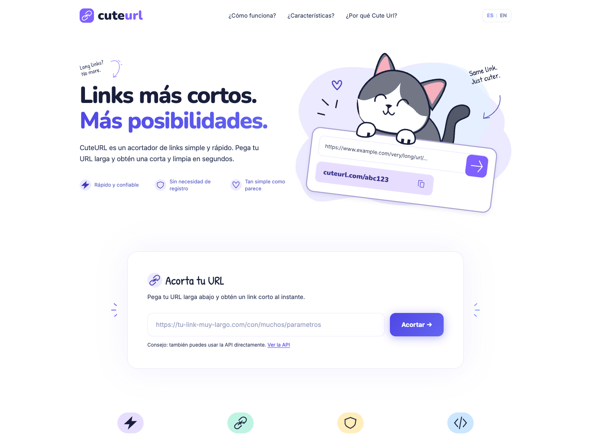

# CuteURL — Frontend

A no-signup URL shortener: paste a long link, get a short one that redirects for 30 days. This is the React landing page and form; the API lives in [CuteURL_Backend](https://github.com/M4NUEL-CERON/CuteURL_Backend) (Spring Boot + Redis).

**Live demo:** [m4nuel-ceron.github.io/CuteURL-Frontend](https://m4nuel-ceron.github.io/CuteURL-Frontend/)

> The API runs on Render's free tier and sleeps after 15 minutes idle. The first link can take up to a minute; the form says "Waking up the server…" instead of looking broken.



[Mobile screenshot](docs/mobile.png)

## What it does

- **One form, one request.** `POST /shorten` with the URL; the response's `shortUrl` is shown with a copy button and a note that it lasts 30 days.
- **Honest states.** Loading spinner, a cold-start message after 3 s, a 90 s timeout, and distinct errors for an invalid URL (400) and an unreachable server.
- **Spanish and English.** Opens in Spanish when the browser is set to Spanish and in English otherwise; the ES | EN switch flips it (`src/translations.ts`).
- **Responsive.** Single column on phones, two columns from tablet up.

## Architecture

```
Browser ── GitHub Pages (this repo, static build)
   │  POST /shorten  {url}
   ▼
Render ── Spring Boot API (CuteURL_Backend)
   │  SET url:{code} {url} NX EX 30d
   ▼
Redis Cloud
```

`GET https://<api>/{code}` answers with a 302 to the original URL, so short links work without the frontend.

## Run it locally

Start the backend first (`docker compose up` in [CuteURL_Backend](https://github.com/M4NUEL-CERON/CuteURL_Backend) gives you the API and a Redis on `:8080`), then:

```bash
npm install
VITE_API_URL=http://localhost:8080 npm run dev
```

The app runs on http://localhost:5173, which is the backend's default allowed CORS origin.

## Deploy

`.github/workflows/deploy.yml` builds and publishes to GitHub Pages on every push to `main`. It reads one repository secret:

| Secret | Value |
| --- | --- |
| `VITE_API_URL` | Backend base URL, e.g. `https://cuteurl.onrender.com` (baked in at build time) |

## Stack

React 18 · TypeScript · Vite 6 · Tailwind CSS 4 · GitHub Actions · GitHub Pages
